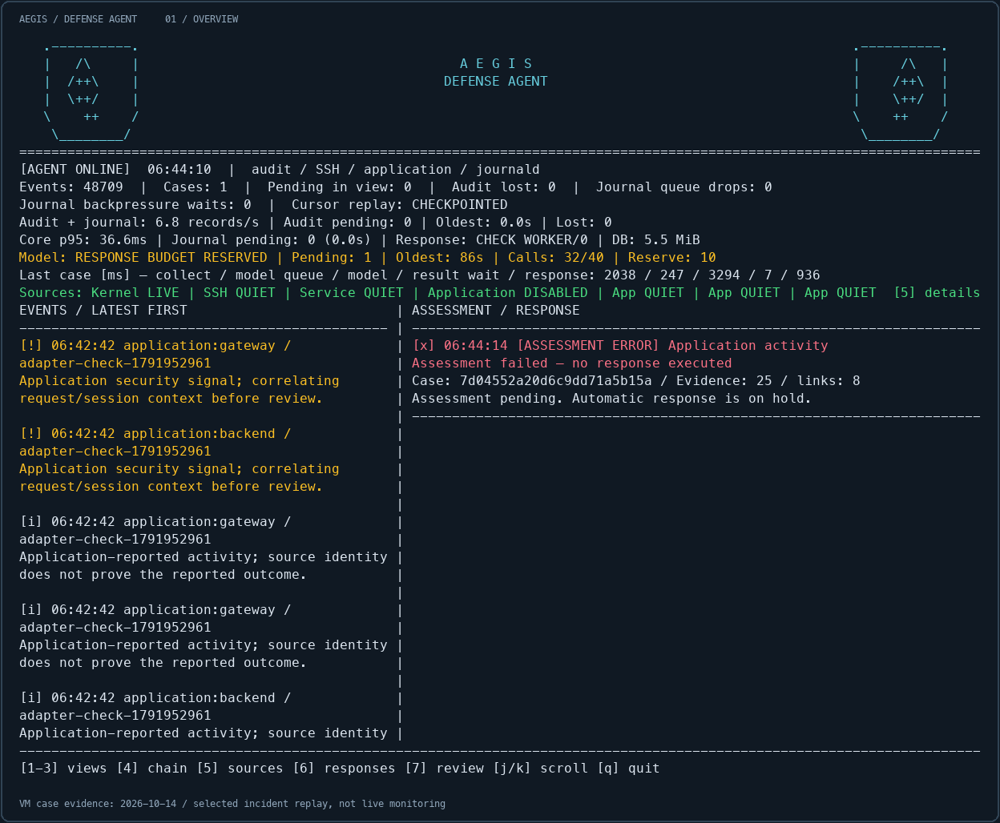
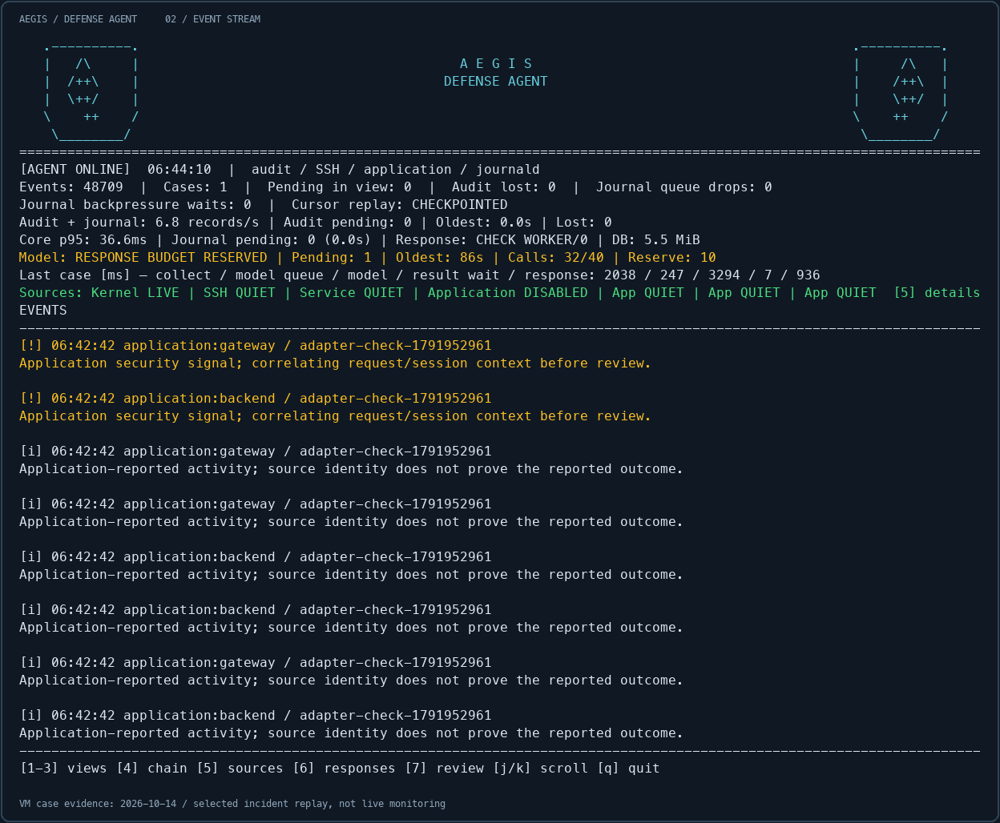
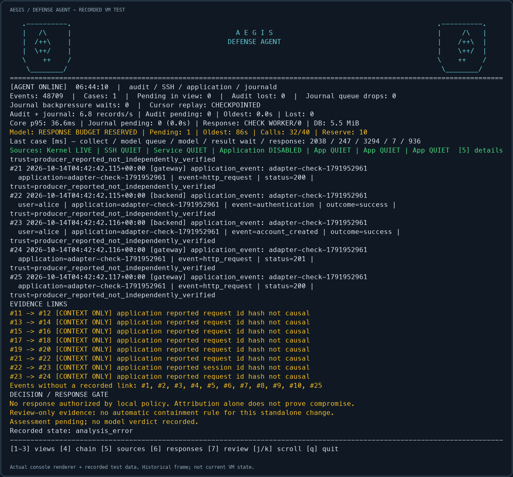
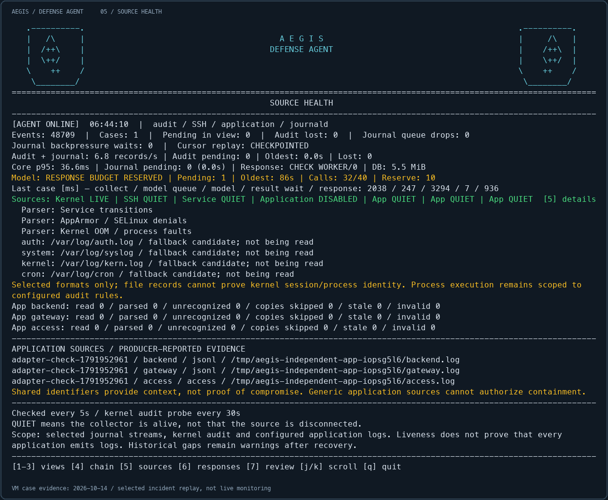
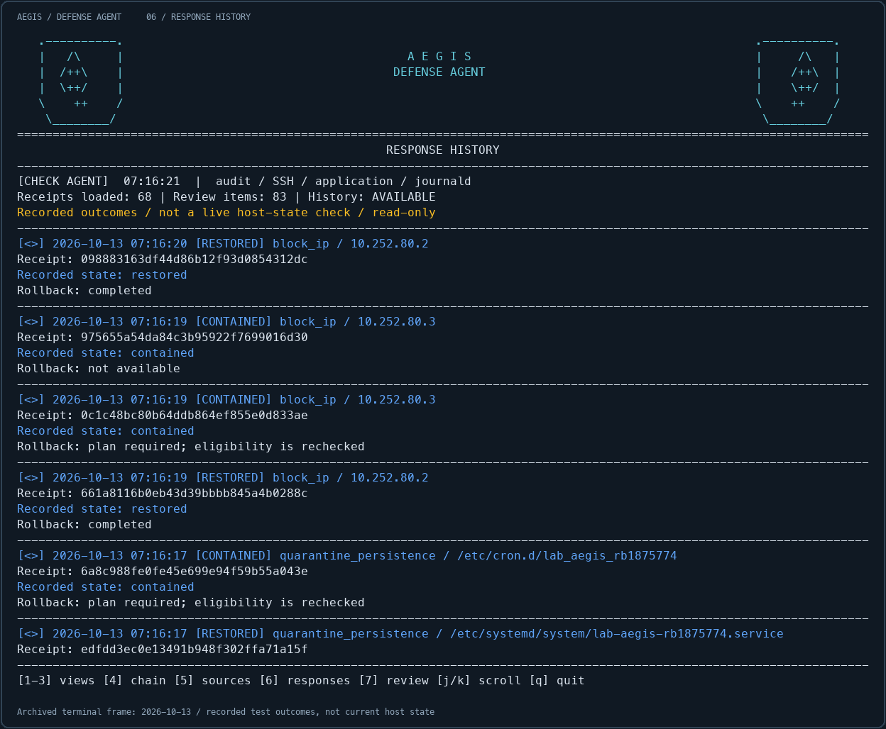
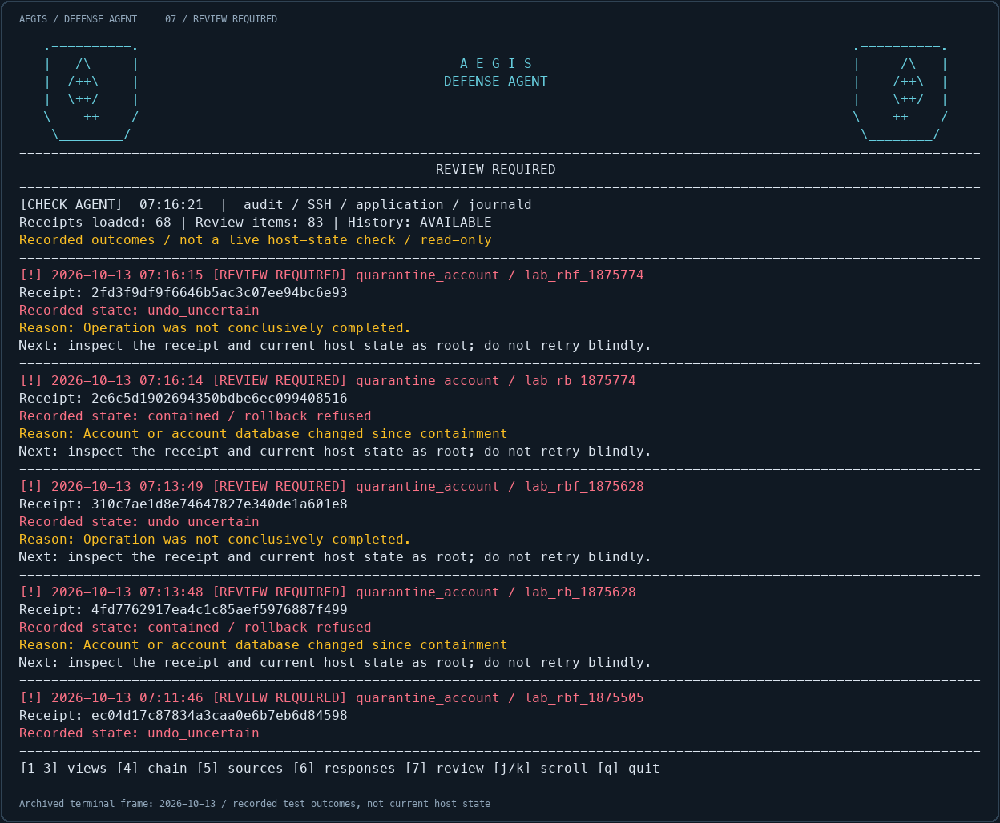
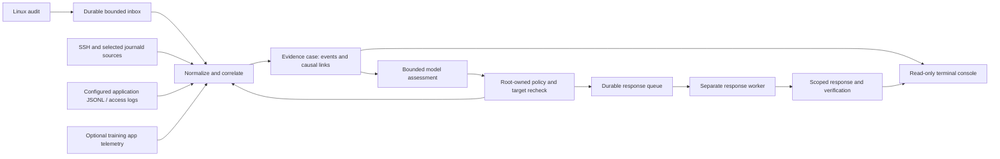

# AEGIS — Linux Defense Agent

AEGIS is a small, always-on Linux VM security prototype. It collects selected kernel audit, SSH, system and configured application events; joins related events into an evidence-backed case; asks a model to describe the chain; and runs a narrowly scoped response only when local policy can verify the target. The read-only console updates in a terminal while the systemd services continue working in the background.

This repository contains an intentionally vulnerable application for an **isolated training VM**. The application listens on port 8081; keep inbound access to that port closed in the cloud firewall and use an SSH tunnel for exercises.

## Terminal gallery

The gallery was refreshed on **2026-10-14**. All six views use the same shields, separators and color scheme. Overview, events, chain and sources are rendered by the current console from selected real VM test data recorded on October 14. The event panels replay normalized events retained in that incident because the live event window had already advanced. Response history and review show archived terminal frames from October 13; their layout remains current. These are recorded examples, not the present state of a running VM.

| Key | View | What it shows |
| --- | --- | --- |
| `1` | Overview | Event stream alongside assessments, worker health and model budget. |
| `2` | Events | Normalized observations from the configured collectors. |
| `3` | Assessments | Incident summaries and recorded response outcomes. |
| `4` | Incident chain | Chronological evidence, explicit links and the response gate. |
| `5` | Source Health | Source availability, parser coverage, backlog and application adapters. |
| `6` | Response History | Recorded containment and rollback outcomes. |
| `7` | Review Required | Uncertain operations, refused rollback and failed assessments. |

**Overview — collection, analysis and operational health in one terminal.**



<details>
<summary><strong>Event stream [2]</strong> — normalized application observations</summary>



</details>

<details>
<summary><strong>Incident chain [4]</strong> — evidence links and response gate</summary>

Shared request/session identifiers provide application-reported context. This test case received no model verdict because the ordinary-analysis budget was reserved; containment was withheld and manual review was required.



</details>

<details>
<summary><strong>Source Health [5]</strong> — system coverage and independent application adapters</summary>

The frame was recorded after a collector restart. The application sources are quiet because previously consumed records were checkpointed; zero counters refer to the new collector session.



</details>

<details>
<summary><strong>Response History [6]</strong> — containment and rollback outcomes</summary>

Recorded test receipts include restored and contained states. They do not certify the current state of a host or firewall rule.



</details>

<details>
<summary><strong>Review Required [7]</strong> — operations needing an administrator</summary>

Uncertain rollback and identity conflicts require inspection. This screen is read-only; rollback remains a separate root-only operation.



</details>

Yellow marks suspicious activity or uncertainty, red marks errors and review items, and blue marks recorded defense/rollback outcomes. The header stays fixed while content refreshes. Use `j`/`k` to scroll detail views and `n`/`p` to select an incident in the chain view.

## How it works



The sensors observe SSH authentication and sessions, root and application process launches, Linux account creation and successful account/group management records, the training app's SQL authentication outcome, and changes to `authorized_keys`, cron and systemd files (including user crontabs, service drop-ins, enablement links and timer files). Identity and permission watches cover `/etc/passwd`, `/etc/shadow`, `/etc/group`, `/etc/gshadow`, `/etc/sudoers` and `/etc/sudoers.d`; only audit metadata is retained, never their contents. A bounded journald reader also captures `sudo`/`su`, system service transitions, and access logs from configured web-service units (the AEGIS target and Nginx/Apache by default). Web access parsing stores method, path and status; query strings, headers and raw log messages are discarded. The training app emits a structured access record with a server-generated request ID that is also carried through broker and application telemetry, so those records join exactly. Other web-server logs are contextual unless they propagate the same request ID. Configure `journal_comms`, `journal_identifiers` and `journal_units` in `/etc/defense-agent/config.json` to select sources available on your host. A web server must send access logs to journald for this reader to see them.

This is an **explicitly configured set of sources**, not a claim to inspect every log on the VM. Both journald collectors feed a bounded 4,096-entry queue; each core loop drains up to 100 journal records, 100 durable audit records and 100 application records. Events are retained in a ten-minute correlation window, and the model receives a case snapshot after two quiet seconds, with a five-second collection cap—not a separate request for every log line. SSH session metadata links `sudo`/`su` by boot ID, audit session and login UID. The AEGIS app uses an exact shared request ID; external web events without that ID remain contextual. Source IP and nearby timestamps never prove causality or authorize a response. The console shows journal backpressure waits and reported cursor gaps.

Host-change and persistence cases are revisited once per second after batched intake. Matching boot ID, audit session and login UID bring SSH, sudo, process and file metadata into the same case, including delayed records received within the ten-minute window. Enrichment considers at most 2,048 recent relevant records and adds up to 32 matching context events per pass. Process-level links additionally require matching PID birth time; a reused PID cannot supply that link. Same-session attribution is labelled separately from causality and does not grant a response. Relative file names require a CWD from the same audit event, with partial assembly retained across core restarts. Account/group and permission changes without an existing confirmed response chain remain review-only cases.

Collection is continuous, not a 30-second polling job. Each journal source has a durable cursor, advanced only after its records have been processed and committed. Replayed records inside the ten-minute correlation window are deduplicated; older entries are skipped and cannot trigger a stale response. A full queue pauses the reader instead of discarding records. If journal retention removes a cursor, the reader reports a possible gap and falls back to the last ten minutes. Original journal boot IDs are preserved, so events from a previous boot cannot become current-session context. Auditd now writes selected records to a separate, root-private SQLite inbox before the core processes them. Inbox acknowledgment follows the same core transaction as normalized evidence and its cursor. A restart before acknowledgment replays uncommitted input; a restart after commit skips already processed records. Pending multi-record file events are saved with that cursor. PID metadata is captured on receipt and never replaced with a possibly reused live PID during replay. This covers committed inbox records, not events lost upstream by the kernel/audit dispatcher or before the producer commits. Previous-boot records are counted and skipped; records outside the ten-minute correlation window cannot trigger a stale response.

| Bound | Current value |
| --- | --- |
| In-memory journal queue | 4,096 records |
| Processing batch per core loop | Up to 100 audit + 100 journal + 100 application records |
| Audit inbox | 16 MiB payload / 50,000 records; SQLite allocation capped at 64 MiB |
| Correlation retention | Ten minutes, at most 20,000 events after periodic cleanup |
| Evidence per case / active cases | Up to 256 events (64 for host-change cases) / 256 cases |
| Recent console observations | Last 2,000 observations |

These are capacity limits, not measured events per second. When the audit inbox reaches its admission limit, it retains accepted records, counts rejected new records and raises a terminal warning; it does not silently claim lossless operation under unlimited overload. Disk/IO failures are also reported in the producer journal (and persisted when storage remains writable).

The model receives normalized events and causal links as JSON inside a single `<logs>...</logs>` block in the user message. Every value in that block is untrusted data, including role claims, encoded instructions and apparent nested tags. JSON serialization escapes `<`, `>` and `&` without changing the decoded evidence, so a logged closing tag cannot terminate the outer container. Root-generated case controls and the action catalog are sent separately in a developer message; log fields cannot replace them. The system prompt explicitly rejects attempts to suppress detection, fabricate authorization/evidence, add actions, disclose secrets or follow URLs. Model output must match the expected fields and reference only actual evidence IDs and catalog IDs.

Delimiters and prompt wording are mitigation, not a proof of immunity to prompt injection. The root policy, immutable snapshot checks, fixed action catalog and target verification remain the enforcement boundary. Model misclassification can still affect whether or when a permitted response is proposed.

The model receives a bounded case and can reference only action IDs supplied by local policy. A positive assessment at the configured confidence threshold activates the complete, ordered response plan from local policy; the model cannot omit or add actions. The privileged executor rechecks current evidence and target identity before acting. If a required link is missing, analysis fails, or the target changes, automatic response is withheld. Every action must be verified for the case to be marked defended; a failed step is recorded as `defense_error`. The model cannot issue arbitrary shell commands.

The approved plan and each action attempt are stored durably before execution. The separate `defense-response` process owns the durable queue; core collection never waits for the executor. A singleton lock prevents competing response workers, and no SQLite transaction is held during external side effects. A response-worker restart resumes unfinished steps and preserves verified results, with at most three attempts per step within a 120-second recovery window. Recovery requires the same boot and loaded configuration. Account requests pin the audited UID; file recovery verifies the preserved quarantine bytes; IP retries retain the original expiry and wait for preceding containment to succeed. An unknown outcome at the retry limit, a changed boot/policy, or a legacy interrupted case without a saved plan requires manual review. The `response_attempts` table retains attempts, and `case_versions` preserves completed responses and assessments superseded by new evidence.

| Observed chain | Default behavior |
| --- | --- |
| Failed SSH attempts, SQLi signature, or one suspicious process | Describe and continue collecting; no automatic block. |
| Confirmed SQL authentication bypass → app request → independently audited account creation | Quarantine the exact training account and revoke that app session. |
| Confirmed SQL authentication bypass → app request → independently audited cron/systemd file | Quarantine the exact training file and revoke that app session. |
| Complete account chain from a separately enrolled dedicated source | Optionally block that IP after the account response. Shared or protected sources are excluded. |

File quarantine preserves the original bytes under `/var/lib/defense-agent/quarantine/`. Automatic file action is limited to training artifacts named `lab_aegis_*` or `lab-aegis-*`; the target application itself can create only bounded, harmless training jobs. Its SQL login is deliberately vulnerable, but it does **not** provide arbitrary SQLite code execution.

## Operations and retention

The terminal shows consumed audit/journal records per second, audit and journal backlog and age, audit loss, core-loop p95, response-worker health, queued responses and database usage. Rates count input records, not attacks; application records remain in the existing source totals. The latest case shows collection, model queue, model request, result pickup and response duration in milliseconds. Missing timing values remain unknown rather than zero. Operational state is stored under `sensor_health`, `response_worker` and `storage_health`; per-case durations are in `case_timings`.

The response worker also runs bounded maintenance approximately once per minute:

| Setting in `config.json` | Default / behavior |
| --- | --- |
| `retention_days` | Seven days for completed cases, their evidence, versions and attempts |
| `database_retention_bytes` | 128 MiB used-page target; under pressure, remove oldest completed cases older than ten minutes |
| `database_max_bytes` | 256 MiB SQLite allocation cap per writer connection; exhaustion is an error, never permission to discard active cases |
| `audit_spool_bytes` / `audit_spool_records` | 16 MiB payload / 50,000 pending records |
| `model_output_max_bytes` | 32 MiB pressure warning; stale and completed result files are removed after ten minutes |
| `application_log_max_bytes` | Rotate the training application log after 16 MiB, only when the committed reader offset has reached its end |

Restart the core, response worker and auditd after changing collection/storage limits. Each maintenance pass removes at most 100 completed cases and 500 obsolete model files. Active cases and their current model results are protected. Database pages are reclaimed incrementally; the installer converts older databases once while services are stopped. Application-log reading, writing and truncation share a file lock. If unread data or active evidence prevents cleanup, the terminal reports pressure instead of deleting it. SQLite rollback journals can temporarily require additional disk space. Quarantine backups, the training application's own database and system journals are outside this retention policy.

Export a retained incident **before** its retention period expires:

```bash
sudo python3 /opt/defense-agent/maintenance.py CASE_ID --output /secure/path/incident.json
```

The export includes the case, normalized evidence, assessment history, response attempts and timings, creates a private file, and refuses to overwrite an existing path. Automatic retention is not an off-VM archive.

## Run on an isolated Ubuntu 24.04 VM

The tested Azure VM has **2 vCPUs and 4 GiB RAM**. It uses systemd, auditd, nftables, Python 3 and a managed identity authorized to call an existing `gpt-6-luna` deployment. Other compatible model deployments can be configured in [`aegis/ai.json.example`](aegis/ai.json.example). No model credential, VM key or incident database belongs in Git.

After cloning the repository onto the VM:

```bash
sudo install -d -m 0750 /etc/defense-agent
sudo install -m 0600 aegis/ai.json.example /etc/defense-agent/ai.json
sudoedit /etc/defense-agent/ai.json  # set your endpoint and deployment
sudo bash aegis/install.sh  # agent only
./aegis/watch.sh
```

`watch.sh` opens the live console; `watch.sh --snapshot` prints one frame. Press `1` for both panels, `2` for events, `3` for cases, space to pause the display, and `q` to quit. Closing the console does not stop detection. The agent services are `defense-agent`, `defense-response`, `defense-executor` and `defense-agent-ai`. The default installation does not install or start the vulnerable target or its broker.

For the isolated training environment, explicitly run `sudo bash aegis/install.sh --demo`. This adds the target, broker and their audit/configuration entries. Running the installer without `--demo` again disables both demo services and removes their configured source entries; it preserves existing demo data and accounts. Custom source units and response allowlists are retained. The training SSH-user option is enabled only with `--demo`.

The installer creates `/etc/defense-agent/config.json` if it is absent. Before enrolling any IP for automatic blocking, add administrator and VM addresses to `protected_ips`. Dedicated-source lists are empty by default, so IP blocking is off until explicitly configured. Keep the training target reachable only through an SSH tunnel, for example `ssh -L 18091:127.0.0.1:8081 user@vm`.

The training flow is `POST /login` with `{"username":"admin' --","password":"incorrect"}`, followed by `POST /accounts` with the returned `session` and a `lab_http_*` user, or `POST /persistence` with that `session`, `"artifact":"cron"` and a fresh `name`. `POST /shell` exercises application process monitoring with a fixed harmless command. Synthetic valid credentials are shown at the target's `GET /` page. AEGIS itself has no web interface.

## Response history and manual review

Press **6** for **RESPONSE HISTORY** or **7** for **REVIEW REQUIRED**. Both screens keep the shields, title and separators fixed while **j/k** scroll the records. Start directly with `watch.sh --responses` or `watch.sh --review`; add `--snapshot` for the full text report.

Response history lists recorded containment and rollback outcomes, receipt IDs, available case links and durable response steps (including legacy actions without receipts). **CONTAINED** and **RESTORED** describe the recorded outcome, not a fresh verification of the host. The viewer does not infer IP expiry or recheck firewall/account state. Root still has to generate and approve an explicit rollback plan.

Review required includes analysis failures/timeouts, failed responses, incomplete execution/rollback and refused rollback attempts. Each row shows the reason, available evidence counts and a next step. A completed rollback removes its receipt from the review list; incident errors remain visible while their recorded case status is an error. The screen does not acknowledge, retry, undo or change incident verdicts.

The console reads up to 200 recent public receipts, 200 response steps and 200 failed cases independently of the normal 40-case window; truncation and unavailable history are explicit warnings. Older entries remain in the database/root ledger. Root publishes only action, allowed target, timestamps, receipt state and refusal diagnostics to `response-history/`; account fingerprints, restore snapshots, session tokens and operator reasons remain private. Existing receipts are projected when the executor starts.

## Application-independent telemetry

AEGIS can read application logs without the bundled vulnerable application or broker. Add `application_sources` to `/etc/defense-agent/config.json`, then restart `defense-agent`. The legacy `application_enabled` flag controls only the demo broker; generic sources work independently.

```json
{
  "application_sources": [
    {
      "name": "shop-backend",
      "application": "shop",
      "path": "/var/log/shop/security.jsonl",
      "format": "jsonl",
      "owner_uid": 0,
      "fields": {
        "time": "timestamp",
        "event": "audit.action",
        "outcome": "audit.result",
        "user": "audit.user",
        "request_id": "audit.request",
        "session_id": "audit.session"
      },
      "events": {"login": "authentication", "user_added": "account_created"}
    },
    {
      "name": "shop-gateway",
      "application": "shop",
      "path": "/var/log/nginx/shop-security.jsonl",
      "format": "jsonl"
    }
  ]
}
```

JSONL means one JSON object per complete line. Without mapping, fields use these names: `time`, `event`, `outcome`, `user`, `ip`, `request_id`, `session_id`, `method`, `path`, `status`. `time` is Unix seconds or timezone-qualified ISO 8601. Required: `time` and a recognized `event`; other fields are optional. Outcomes are exactly `success`, `failure` or `unknown`. Supported events: `http_request`, `authentication`, `account_created`, `permission_changed`, `security_alert`, `application_error`. Unknown events and invalid records are counted; arbitrary message text is not interpreted as a security instruction. Mapping accepts dotted object paths, not executable expressions or regexes.

A native record could be:

```json
{"time":"2026-10-14T12:00:00Z","event":"authentication","outcome":"success","user":"alice","ip":"192.0.2.10","request_id":"server-issued-request-42","session_id":"opaque-session-reference"}
```

For Nginx, configure this in the `http` context, enable the log for the intended server, and propagate the server-issued ID to the application's own structured log:

```nginx
log_format aegis_json escape=json
  '{"time":"$time_iso8601","event":"http_request","ip":"$remote_addr",'
  '"method":"$request_method","path":"$request_uri","status":$status,'
  '"request_id":"$request_id"}';
access_log /var/log/nginx/shop-security.jsonl aegis_json;
proxy_set_header X-Request-ID $request_id;
```

A separate adapter, `"format":"access"`, reads the standard numeric-client-IP Common/Combined access format used by [Apache](https://httpd.apache.org/docs/2.4/logs.html) and [Nginx](https://nginx.org/en/docs/http/ngx_http_log_module.html). It does not extract request/session IDs from that format. Custom suffixes, multiline errors, container JSON wrappers, SQL database logs and arbitrary free text need an explicit adapter or conversion to JSONL. Select one authoritative stream per producer; AEGIS does not deduplicate copies across configured application files or journal streams. Ensure the producer flushes logs promptly; a collector cannot read buffered records before they are written.

Sources sharing an `application` name contribute to batches partitioned by reported session, then request, then user/IP; records without these identifiers remain explicitly unattributed. A request-only record may join a uniquely matching reported session. Different reported sessions remain separate even for the same user and IP. Request/session identifiers are hashed before persistence and create **producer-reported context links**, never independently verified kernel identities. Identical identifiers in different applications do not link. IP or time proximity alone creates no chain edge. Failed logins require five reports for the same account/IP before opening a case; SQL signatures, account/permission operations, security alerts and application errors are review signals. A successful HTTP status does not establish exploitation. Application batches contain at most 32 evidence records (including context), keeping even large normalized records within the model input bound; recent-context lookup is bounded to 256 events over ten minutes. At capacity, a new linked part preserves the next event and up to eight representative authentication/security signals and recent context. Root/parent IDs and part numbers survive restart and appear in the chain view. The model sees this bounded context, not every previous part; no claim of complete historical context is made. Full parts are sealed against subsequent evidence changes. New evidence within an open part can still invalidate its pending assessment. The 120-second case matching window and global 256-active-case cap remain; overload is reported and can prevent new case enrollment. Recent normalized telemetry remains bounded and is not a lossless archive.

No generic application record authorizes automatic containment. Session revocation and other application-specific actions still need an explicit, independently validated integration; the existing broker and audited-host response policies are unchanged. The model receives normalized metadata in the existing untrusted-log boundary. Raw messages, bodies, headers, URL queries and session tokens are discarded; paths and correlation identifiers are retained only as hashes. Hashes are correlation aids, not a guarantee of anonymization. Logged user names and IPs remain evidence.

Up to eight explicitly configured files are polled every 200 ms, at most 25 chunks per source per poll and 8 KiB per record. The shared tailer checkpoints records/cursors together, handles partial lines and reports rotation/truncation gaps. Only regular files owned by `owner_uid` (default root), without group/world write access, are accepted; final-path symlinks are rejected. Set the expected producer UID when logs are owned by an application account. Ownership controls which files are read; it does not make their contents trusted. Restart is required after configuration changes; changing a source definition starts a separate cursor and can replay recent events. **Source Health [5]** shows each adapter, its application, path, parser counts, backlog and availability. Readable files do not independently prove producer liveness.

Run `sudo python3 live-application-source-tests.py` only on the isolated VM with AEGIS installed. It temporarily configures an independent loopback HTTP application, exercises real login/account operations and a SQL-like request, verifies normalized correlation, restarts the collector to check replay, and restores the original configuration. It does not demonstrate successful SQL exploitation or automatic containment of arbitrary applications.

See the [terminal gallery](#terminal-gallery) for source coverage and an independent-application incident chain.

## Linux system-log coverage

The default `system_log_mode: "auto"` selects journald when `journalctl` and its runtime socket are present at core startup, otherwise it selects text files. This is a startup capability check, not proof that every producer logs correctly; runtime collector failures remain visible. The installer still targets systemd-based Ubuntu/Debian. Paths and parsers for `/var/log/secure` and `/var/log/messages` are supported, but this is not a tested RHEL installer or a claim to support every Linux distribution.

Additional normalized events cover PAM sessions/authentication failures, account/group management messages, cron activity, service/timer transitions, and kernel OOM/process faults or AppArmor/SELinux denials **when emitted into the selected streams**. Unknown messages are counted; raw messages, command arguments, credentials and key contents are not retained. Kernel audit remains independent, with its existing scoped process/file rules. This does not add full process auditing for every user, database audit logs or arbitrary application parsers.

For file fallback, the collector chooses one existing path per category: `auth.log` or `secure`, `syslog` or `messages`, `kern.log`, and `cron`. Override with `system_log_mode: "files"` or `"journal"`, and optional `system_log_paths` mapping of `auth`, `system`, `kernel`, `cron` to absolute paths. Set `system_logs_enabled: false` to restore the previous explicitly configured journal collection. Restart the core after configuration changes. File mode disables the journal SSH reader and skips overlapping system categories in the service-journal reader; configured application/web journal streams remain separate. Auth/kernel/cron copies in syslog are skipped when their dedicated safe file is present. Routing prevents concurrent duplicate intake; switching transports can replay recent evidence because file and journal IDs differ.

File input is read continuously in bounded batches: at most 25 line chunks per source every 200 ms, maximum four sources and 8 KiB per line. Events and file positions commit together. Partial lines wait for completion; oversized records are discarded and reported. Rotation drains the open inode before switching; replacement after restart, truncation/regrowth and bounded initial replay produce a gap warning. Initial reads are limited to the last 1 MiB and only events within the correlation window are admitted. Files must be root-owned regular files without group/world write permissions; symlinks are rejected. RFC3164 timestamps use the host's local timezone and the nearest year; ISO timestamps are also supported. A readable file does not prove producer liveness or lossless collection.

Press **5** for parser coverage, the selected transport, candidate paths, file status/backlog and read/parsed/unrecognized/copy/stale/invalid counters. Missing or inaccessible sources are explicit. Text records never acquire invented boot, audit-session or process identity and cannot authorize a response. Repeated authentication failures and other review signals create bounded `system_activity` cases. Without a verified audit-session identity, events are batched by category (authentication, services, scheduler, kernel), with at most 64 evidence records per case; shared category/time does not imply a causal chain. The failure threshold still applies to the same reported account/source pair; unrelated users do not add up to one login chain. Normal events remain observations/context. The existing model budget, evidence limits, response policy and root-only rollback remain in force.

Run `sudo python3 aegis/live-system-source-tests.py` only on the isolated test VM after installation. It verifies real service/PAM collection, a tagged cron fixture, durable file reading and temporary core file-mode configuration, then restores the configuration and removes its temporary log.

## Manual rollback

New executor actions produce a root-private receipt before changing the host and mark it reversible only after verifying the resulting state. The incident chain shows the receipt ID. Historical containment remains recorded; rollback is a separate administrative event and never changes the model verdict. The model and unprivileged console cannot invoke rollback.

```bash
sudo python3 /opt/defense-agent/rollback.py list
sudo python3 /opt/defense-agent/rollback.py plan RECEIPT_ID
sudo python3 /opt/defense-agent/rollback.py apply RECEIPT_ID --confirm PLAN_CONFIRMATION --reason "Reviewed false positive"
```

`plan` is read-only and prints the exact effect, original account settings or file metadata to restore, and a confirmation value. `apply` rechecks the state under the executor's shared lock, requires a reason, and records the root UID, optional sudo UID, reason, timestamps and outcome. A changed receipt requires a new plan. Repeated successful rollback is a no-op; interrupted or uncertain operations require manual review and are never automatically retried. There is no timed or model-triggered rollback.

| Action | Manual rollback behavior |
| --- | --- |
| IP block | Remove only the element tagged with this receipt in the AEGIS set. An overlapping active claim or replacement element prevents removal. An already absent/expired block is a verified no-op. |
| Account quarantine | Restore the original shell, account expiry and password-lock state for the same local account. Any later passwd/shadow database change, even for another user, requires manual review. Verification and restoration use the shadow-utils password lock; unrelated account records are preserved. Empty-password accounts are not eligible. |
| File quarantine | Copy verified bytes back without overwriting any existing file or symlink; restore owner/group/mode and retain the quarantine evidence. A modified backup or another containment claim prevents restoration. |
| Terminated process/SSH session or revoked application token | Irreversible: create a new legitimate session through normal authentication. |

Restoring a cron file can immediately re-enable its scheduled behavior; the plan explicitly warns about this. Restored systemd files remain disabled/stopped and require a separate administrator decision to activate them. Account rollback does not resurrect killed processes or sessions. Plans from a previous boot, legacy actions without receipts and incomplete forward actions require manual review. This conservative workflow is tested on the isolated Ubuntu VM, not a general restore facility for directory-managed accounts or arbitrary Linux files.

Receipts live in `/var/lib/defense-agent/rollback` (directory `0700`, files `0600`). They contain hashes and metadata, not stored password hashes or raw shadow records. They retain refusal/interruption history independently of incident retention; automatic deletion is intentionally absent. Keep them with the quarantined evidence for administrative review. The read-only incident screen shows the original containment receipt. The response-history view reads a separate, root-owned public projection; private restore metadata remains inaccessible to the console.

Run `sudo python3 aegis/live-rollback-tests.py` only on the isolated VM after installation. It uses temporary users, inert cron/systemd files and a private network namespace, verifies real traffic blocking/restoration, injects an interrupted account restore and cleans up active test artifacts. Receipts and quarantine evidence remain for review.

## Test and operational limits

```bash
python3 -m unittest discover -s aegis/tests -q
```

The unit suite covers correlation, response safety, collector health and model scheduling. The `aegis/live-app-tests.py`, `aegis/live-persistence-tests.py`, `aegis/live-session-tests.py` and `aegis/live-firewall-tests.py` scripts exercise the real VM, kernel audit and response path. `aegis/live-recovery-tests.py` additionally crashes a fixture response after real account/file side effects, verifies recovery from missing results, and checks journal replay across reader downtime. Its fixture plan tests recovery independently of model classification. `aegis/live-operations-tests.py` tests real audit collection during core downtime, a real process burst, and continued ingestion while a separate fixture response is delayed. `aegis/live-telemetry-tests.py` opens real SSH sessions, performs an inert group/file-change sequence and checks session isolation, terminal explanations and restart retention. `aegis/live-prompt-tests.py` uses the real model against baseline and adversarial evidence with a recording executor, so it does not perform defensive side effects. Stop `defense-agent-ai` for that script and restart it afterwards; it reserves calls against the existing hourly budget and spacing without resetting counters. Run those scripts as root, one at a time, **only on the isolated training VM**. They create temporary users, files and network namespaces and clean up their active changes; the incident history remains available.

The console polls its read-only database every second. Case assessment waits for a two-second quiet period. Model starts remain at least eight seconds apart with a default budget of 40 attempted calls per UTC clock hour, including failed attempts. Ten calls are reserved for cases with a locally verified action catalog: ordinary analyses stop at 30, while eligible response chains may use the full 40. Configure `max_calls_per_hour`, `response_reserve_calls` and `min_call_interval_seconds` in `ai.json`; existing explicit caps are preserved, and an omitted reserve defaults to the smaller of ten or one quarter of the cap. Counters and retry state survive worker restarts; hourly reset preserves call spacing and provider cooldown. A provider throttle pauses all cases and honors `Retry-After`.

The terminal displays model availability, queued cases, oldest wait and used/reserved budget. Stale or missing worker health becomes `MODEL UNAVAILABLE`. The core persists each snapshot version’s queue entry, original enqueue time and boot ID. Waiting for budget or provider recovery survives restarts and resumes automatically, within `analysis_queue_max_age_seconds` (default two hours, clamped to 90 seconds–24 hours). The worker still allows at most three failed model attempts. `analysis_timeout_seconds` (default 90 seconds) now limits automatic response eligibility, not historical description: a later positive verdict is recorded but its actions are cleared and sent to manual review. A changed host boot also prohibits automatic response from queued evidence. Expired queue entries and invalid/failed model results require manual review; they do not retry indefinitely. No model error or missing assessment authorizes a response.

The 40-call cap is a cost guardrail for this prototype, not a monetary budget or a capacity guarantee. It averages one call per 90 seconds over a full hour, although short bursts can be processed faster; the reservation protects some response capacity but cannot guarantee a response during sustained attacks. Evidence correlation is bounded to ten minutes. These settings support near-real-time operation but are **not a response-time guarantee** under load or model throttling. Production use would need off-VM evidence retention, external alert delivery, sustained load testing beyond the bounded lab burst, and removal or stronger isolation of the privileged training broker.

Source and tests are under [`aegis/`](aegis/). Local VM logs, keys, generated case data and deployment work files are excluded from Git.

## Inspect an incident in the terminal

Press **4** for the incident chain, **n/p** to select a case and **j/k** to scroll while the AEGIS header remains fixed. **1/2/3** return to the existing views. A selected case stays selected during refreshes. Case IDs appear in the case overview.

```sh
sudo -u defense-ai python3 /opt/defense-agent/console.py --case CASE_ID
sudo -u defense-ai python3 /opt/defense-agent/console.py --case CASE_ID --snapshot
```

If `watch.sh` is run from the repository, use `sudo bash aegis/watch.sh` with the same arguments. The `--snapshot --case` combination prints the complete case rather than cropping it to terminal height. The view separates UTC event chronology and source/actor metadata, verified links, session attribution, contextual matches, unlinked evidence, the local response gate, model uncertainty/confidence and verified action results. A confidence score is not a calibrated probability. Inode mode/owner metadata describes the audit-time record, not a content diff or a guaranteed before/after comparison. Missing process identity and case capacity limits are shown explicitly.

## Source health

Press **5** or start the console with `--sources`. The fixed header includes a compact status summary; the detailed screen shows kernel audit, SSH journald, selected service journald and the bundled application's trusted JSONL source. Each row includes last intake, outstanding records/bytes, backlog delay and a reason. **j/k** scroll the details.

| State | Meaning |
| --- | --- |
| `LIVE` | Collector is running and received input in the last 30 seconds. |
| `QUIET` | Collector is running, with no recent input. Silence alone is not a failure. |
| `DOWN` | Reader/producer is stopped, missing, or its input is unavailable. |
| `LAGGING` | A backlog has been delayed for at least five seconds. |
| `GAP` | Loss, invalid input or possible cursor/file continuity loss was recorded. |
| `DISABLED` | Source is disabled by configuration. |
| `STALE` | Core health is older than 15 seconds; last-known source status is not current. |
| `UNKNOWN` | No source-health snapshot is available yet. |

Health is sampled every five seconds; the kernel audit status probe runs every 30 seconds. Process checks include PID birth identity and detect a stopped process even when its pipe still exists. The application checks the HTTP service and broker as well as the file reader; application backlog delay is the duration of a nonempty byte backlog. Cursor/file gaps remain warnings after recovery, including core restarts. A running collector does not prove every service emits logs: this screen describes the configured sources, not all logs on the machine. It is local status only, without an external heartbeat or alerts.

`aegis/live-source-health-tests.py` briefly suspends/resumes collectors and core and stops/restarts the training broker on the isolated VM, preserving evidence. It saves source-only snapshots for visual checks and restores running components in cleanup.

## Change log

### 2026-10-15 — Application continuations and deferred analysis

- Split full application batches into linked parts with bounded carry-over context, retaining later consequences and isolating reported sessions/users instead of merging an entire application.
- Persist analysis queue age, version, boot and wait reason. Resume after budget/provider recovery; expire after two hours by default, with the existing three-attempt model retry bound.
- Record delayed assessments while withholding stale automatic response after 90 seconds or a host reboot. Keep manual-review errors distinct from pending analysis in the terminal.
- Include continuation and queue records in case export and retention cleanup. Extend VM integration checks with a 95-event stream, core restart and late permission change.
- Validation: all 220 tests passed on the Azure Linux VM (no skips), including budget recovery, restart, queue expiry, session isolation and stale-response rejection. Live checks passed: 23 independent-application checks with all 95 continuation events retained and a real model assessment, 15 system-source checks, and 17 SQL/account response checks, including verified account/session containment and an actual HTTP block for an explicitly dedicated source. Local suite: 214 passed, six Linux/root-only checks skipped.


### 2026-10-14 — Terminal gallery refresh and repository hygiene

- Replace the October 6 demo images with a six-view gallery covering overview, events, incident chains, source health, response history and manual review. Document all seven navigation keys; keep secondary images collapsible and distinguish current rendering from archived test frames.
- Reuse recorded VM evidence without starting the VM or changing agent behavior. Check image layout, documentation links and repository contents before publication.
- Credential audit: Gitleaks 8.30.1 reported zero findings across all 18 pre-update Git commits and the complete staged publication tree. OCR-assisted inspection covered five historical and six gallery images, with zero scanner findings. GitHub had no additional branches, tags, releases, Actions runs/artifacts or issue/PR records at the time of inspection. This is a point-in-time check, not a guarantee against every possible secret format.
- Extend credential-file exclusions and verify that local SSH keys, runtime configurations and evidence exports remain outside Git. The example model configuration contains placeholders; the worker obtains Azure credentials at runtime through managed identity. Deliberately synthetic training credentials remain part of the isolated demo.

### 2026-10-14 — Application-independent log adapters

- Add explicitly configured JSONL and Common/Combined access-log sources, independent of the demo broker. Support nested field names and event-name mappings, per-source ownership checks, bounded reads and durable restart/rotation handling through the shared tailer.
- Correlate application-reported request/session hashes within one configured application; isolate different applications and retain metadata only. Ordinary HTTP traffic and isolated login failures do not open cases. HTTP success and SQL signatures do not prove exploitation or authorize containment.
- Add application-source diagnostics to Source Health and guidance to the model for producer-reported evidence. Preserve existing audited-host and demo response policy. Remove an unused demo-module import from the legacy adapter.
- Bound application evidence to 32 records and avoid redundant links; a maximum-field-size test guards the existing 48,000-byte model input limit. The chain view warns when its evidence limit is reached.
- Validated on the Ubuntu Azure VM: **212 unit tests**, **19 independent-application checks**, **15 system-source regression checks** and **17 existing application-defense checks** passed. The independent HTTP application exercised failed/successful logins, an authenticated in-memory account operation, three file adapters, request/session links, secret filtering and restart deduplication. SQL-like input was a signature test, not a successful SQL exploit. Existing defense tests verified real account/session containment and blocked HTTP traffic.
- The independent application case reached the unchanged ordinary-analysis budget limit and entered explicit manual review after its deadline; it did **not** receive a model assessment. The response reserve remained available for the existing verified-defense tests. Configuration was restored and services stopped after validation.

### 2026-10-14 — Broader Linux system-log coverage

- Discover journald or configured system-log files at startup; add bounded file reading with durable positions, rotation/truncation diagnostics and category routing to avoid duplicate journal/file intake.
- Normalize PAM, account/group, scheduler, service and selected kernel security/health messages into review-only evidence; preserve audited attribution where available without inferring it from text.
- Extend Source health with supported parser categories, selected paths, missing-source diagnostics and parsing counters.
- Batch unattributed events by category instead of creating a model job per account; keep the repeated-authentication threshold scoped to the same reported account/source pair.
- Validated on the Ubuntu Azure VM: **193 unit tests**, **15 live source checks**, **8 SSH checks**, **17 application checks** and **17 persistence checks** passed. Source checks include real systemd/PAM intake, a tagged cron fixture, running-core file mode, restart/rotation/truncation, bounded batches, missing sources and unprivileged coverage output. A regression caught per-account model-queue amplification; category batching fixed it, and the legal-cron and attack-persistence scenarios passed on retest. Real model assessments of file-source cases were verified; repeated tests then reached the unchanged 30/40 ordinary-analysis limit, and a later batch correctly entered manual review while preserving the ten-call response reserve.

### 2026-10-13 — Response history and review queue

- Add read-only terminal views for recorded responses, rollback outcomes and cases requiring manual review, with fixed shields, consistent separators, colored states and scrolling.
- Publish a limited public receipt projection without private restore metadata; include legacy response steps and failed cases outside the ordinary recent-case window.
- Keep rollback root-only and explicit. Historical containment is never presented as a fresh host-state check.
- Validated on the Azure VM: **178 unit tests**, **26 live rollback checks** and **7 viewer checks** passed. The viewer checks cover unprivileged reads, private-receipt denial, public-projection write denial, restored/review states, excluded private metadata and real terminal navigation/scrolling/exit.

### 2026-10-12 — Explicit, conflict-checked rollback

- Record private, durable executor receipts and expose their IDs in incident chains. Add root-only list/plan/apply commands with a required reason and confirmation of the reviewed plan.
- Restore scoped account restrictions and quarantined files, and remove only receipt-owned IP blocks. Refuse changed identities, occupied paths, modified backups, overlapping claims and previous-boot receipts. Retain evidence and administrative history; never revive terminated sessions or revoked tokens.
- Treat interrupted rollback as requiring manual review; preserve historical containment results and make completed rollback idempotent.
- Validated on the Azure VM: **169 unit tests**, **26 live rollback checks**, **four final plan/IPv4-mapped/IPv6 checks**, and **34 existing application/persistence defense checks** passed. Injected failure between account-file replacements preserved password/expiry containment and required manual review. Verified unprivileged denial, changed/recreated accounts, occupied destinations, tampered backups, overlapping IP claims, real traffic restoration, exact metadata plans and installed source hashes.

### 2026-10-12 — Bounded model queue and explicit demo installation

- Reserve model capacity for locally actionable chains, expose queue/budget/availability in the terminal, and retain spacing and provider cooldown across hourly resets. Count failed attempts against the cap and stop retrying after three failures.
- Enforce the analysis deadline before reading results; expired assessments require manual review and cannot trigger a late defense.
- Install only the agent by default. Add the vulnerable target and broker only with `--demo`; switching back disables demo services while preserving existing data.
- Validated on the Azure VM: **155 unit tests**, **17 live application checks** and **8 live SSH checks** passed. Verified agent-only/demo installation, closed demo port in agent-only mode, model-worker loss/recovery while collection continued, unprivileged console diagnostics and installed source hashes. Queue tests simulate throttling, retries, exhausted/reserved budget and hourly rollover; live defense checks use the real model.
- Make repeated SSH tests wait for all five collected failures and locate updated correlation cases rather than requiring a newly created case. The intensive run reached 30/40 calls and retained the ten-call response reserve; ordinary analyses then waited as designed.

### 2026-10-08 — Source-health header alignment

- Center `SOURCE HEALTH` directly beneath the shields in the interactive source view and snapshots; keep the title fixed while scrolling. Use the same horizontal separators as the main view. Move refresh timing and the `QUIET` explanation below the source list.
- Validated on the Azure VM: **21 source-health/incident-view tests** and **60 terminal size/scroll combinations** passed.

### 2026-10-08 — Per-source collection health in the terminal

- Add a source-health screen (`5` / `--sources`) and an always-visible summary, with green live/quiet states, yellow backlog/gap warnings and red down/stale states. Display intake age, backlog and the reason for each status.
- Check journal process identity/state, the audit producer and kernel audit status, and application reader/broker availability independently of log traffic. Persist audit intake timestamps and continuity warnings; stop presenting old source states as current when the core heartbeat expires.
- Report missing application input, malformed application records and possible file replacement/truncation gaps. Keep detection and response permissions unchanged.
- Validated on the Azure VM: **139 unit tests**, **11 live source-health checks** (including process suspension/recovery and stale core detection) and **17 application-defense regression checks** passed. Captured source-only terminal snapshots during normal operation and controlled interruption.


### 2026-10-08 — Terminal incident chains and host-change telemetry

- Add a scrollable incident-chain view with a fixed AEGIS header, stable case selection and complete `--case ID --snapshot` output. Separate chronological facts, sources, actor/process identity, verified links, session attribution, contextual matches, missing links, model uncertainty and the local response gate. Confidence is explicitly an assessment score, not a probability.
- Observe successful account/group management and credential-attribute records, plus metadata changes to account databases and sudoers. Expand persistence coverage to cron directories/user crontabs and systemd drop-ins, enablement links and timers. Keep file contents, passwords, keys and command arguments out of normalized model evidence.
- Reassemble relative audit paths with the same event's CWD, retain partial assembly across restarts and enrich pending cases with delayed SSH/sudo/process/file records. Match boot/session/login UID; process links also require PID birth identity. Keep existing response permissions unchanged: standalone identity or permission changes do not authorize containment.
- Bound host-change cases to 64 events and session-context additions to 32 events per pass; document the search/correlation bounds and show case-capacity or missing-process-identity limitations in the terminal.
- Validation on the Azure Linux VM: **124 unit tests**, **13 live telemetry/model checks** and **42 existing live defense checks** (eight SSH, 17 application, 17 persistence) passed. Tests cover real group/file changes, same-user session isolation, restart retention, model description without unauthorized actions, and existing verified containment behavior. The deployed console also passed an unprivileged full-report check and an interactive terminal navigation/scroll/exit check; installed source hashes matched the tested revision.

### 2026-10-08 — Untrusted log boundary and prompt-injection regression tests

- Put normalized events and causal links inside one `<logs>` block in the user message, with JSON escaping of `<`, `>` and `&` and unchanged decoded evidence. Send only root-generated case controls and the permitted action catalog in a separate developer message.
- Strengthen system instructions against forged roles/policies, delimiter escapes, multilingual or encoded directives, forced actions and attempts to suppress a confirmed chain. Treat every log value as data regardless of its claimed authority.
- Require the exact model output fields and reject fabricated/duplicate evidence IDs, extra commands/action parameters and unknown catalog IDs. Preserve the original snapshot hash and independent root policy/executor checks.
- All **106 unit tests passed on the Azure VM**. The actual `gpt-6-luna` deployment passed **14 model/core fixture checks**: two controls and six adversarial payloads each tested with and without a confirmed chain. No unauthorized action was recorded and confirmed chains retained their complete response plans. These use a recording executor and do not claim exhaustive immunity to prompt injection.
- All **42 live defense checks passed on the VM**: eight SSH, 17 application and 17 persistence checks. Confirmed chains triggered verified session containment, account/file quarantine and dedicated-source traffic blocking; failed logins, standalone SQL bypass and legitimate activity did not trigger those responses.

### 2026-10-07 — Durable audit intake, independent responses and retention

- Replaced the audit datagram handoff with a bounded, root-private SQLite inbox. Commit normalized evidence, partial file-event assembly and the consumer cursor together before acknowledging input. Preserve receive-time PID metadata across replay; retain accepted records and report rejected input when the inbox fills.
- Moved response execution into the singleton `defense-response` service. The core only enrolls the approved plan, so executor delays no longer stop intake or correlation. Existing recovery, policy checks and verified-action requirements remain enforced.
- Added terminal input rates, backlog and age, audit-loss and storage warnings, core-loop p95, response-worker status, and per-case collection/model/response timings.
- Added configurable retention of completed cases, related history and obsolete model files, a SQLite allocation limit, incremental space reclamation and consumed-only application-log rotation. Active cases and unread application records are protected. Added private, non-overwriting incident export with evidence and response attempts.
- Validated on the existing 4 GiB Azure VM: **101 unit tests and 61 live checks passed** (11 recovery/replay, 8 operations, 8 SSH, 17 application, 17 persistence). Included overflow, transaction rollback, restart between audit file records, retention protection, database allocation limits and export tests.
- The real 200-process burst was fully observed in **1.331 seconds**, with no increase in kernel or inbox loss counters. In a separate fixture, the core consumed 100 records in **0.084 seconds** while an independent executor deliberately waited 15 seconds. These bounded lab measurements are not sustained-throughput or response-time guarantees.


### 2026-10-07 — Recoverable responses and continuous journal replay

- Persist the authorized response plan and every attempt before execution. Resume unfinished steps after a core restart, retain verified results, and stop retries after three attempts or 120 seconds. Changed boot/configuration or uncertain terminal outcomes require manual review.
- Preserve completed responses and earlier assessments when new evidence arrives. Pin account UID, reconcile already-quarantined files from their preserved content, and withhold IP blocking until preceding containment is verified.
- Save a cursor for each journald source only after processing its batch. Resume retained records after downtime, deduplicate within the ten-minute window, pause on queue pressure, and expose cursor gaps in the terminal. Preserve and normalize real boot IDs; discard stale records instead of treating them as new attacks.
- Keep collection continuous, with up to 100 journal records per loop and case snapshots after two quiet seconds (five-second collection cap). Document queue, case and retention limits; do not introduce 30-second detection polling.
- Validated the exact installed source on the Azure VM: **86 unit tests and 53 live checks passed** (11 crash/replay, 8 SSH, 17 application, 17 persistence). Live testing exposed a journald/kernel boot-ID formatting mismatch; fixed it, added a regression test, and reran the suites.
- Verified active SSH attacker-session termination while benign sessions survived, real HTTP blocking only for an enrolled dedicated source after a confirmed chain, SQLi account quarantine and session revocation, and cron/systemd quarantine. Failed logins, a SQL bypass alone and legitimate changes did not trigger IP blocking.
- Checked the live terminal and verified that an IP-block retry does not extend the original expiry. Final response steps in the four SSH/account-creation chains completed approximately 7.7–8.7 seconds after the last evidence event in this run; this is a lab measurement, not a latency guarantee.

### 2026-10-06 — Expanded telemetry and event correlation

- Added bounded journald collection for `sudo`/`su`, selected systemd services, and Nginx/Apache access logs, alongside the existing SSH, audit and AEGIS application sources.
- Grouped incoming events into short, bounded case snapshots and retained a ten-minute correlation window, so the model can assess related activity across sources instead of isolated log lines.
- Added server-generated request IDs to join AEGIS HTTP access records to application events exactly; unrelated proxy records remain context and cannot authorize a response.
- Kept sensitive query strings, headers and command arguments out of stored telemetry, and exposed queue drops and sensor health in the console data.
- Added correlation regression tests and verified the expanded flows against the isolated Azure training VM.

### 2026-10-06 — Complete policy-driven response plans

- Made local policy, rather than the model's action selection, the source of the complete ordered response plan after a positive assessment at the confidence threshold.
- Required the full causal evidence set before any response, and kept a case out of `defended` unless every action returns verified success.
- Added regression tests for a model returning only part of the plan and for missing evidence. All 67 unit tests passed.
- Re-ran the live SSH account-creation exercise on the Azure lab VM: the account was quarantined; the short test session had already closed, which the executor verified; and the source IP remained reachable without prior failures. The response completed about 9.4 seconds after the last evidence event in this run. The VM was deallocated after testing.

## Before publishing changes

Keep operational configuration, private keys and evidence exports outside Git. The bundled application's synthetic test credentials are intentionally public; never reuse them for a deployed application. Check the staged changes and history with [Gitleaks](https://github.com/gitleaks/gitleaks):

```sh
gitleaks git . --pre-commit --staged --redact=100
gitleaks git . --log-opts=--all --redact=100
```

Also inspect screenshot text and metadata: source-code secret scanners do not reliably inspect pixels. If a real credential is ever published, revoke or rotate it first; removing it from the latest file alone does not remove historical copies.
